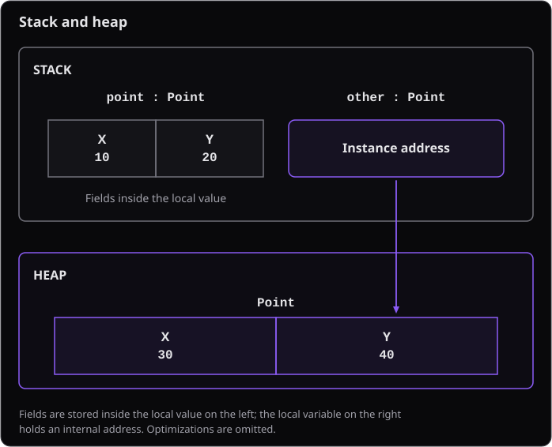
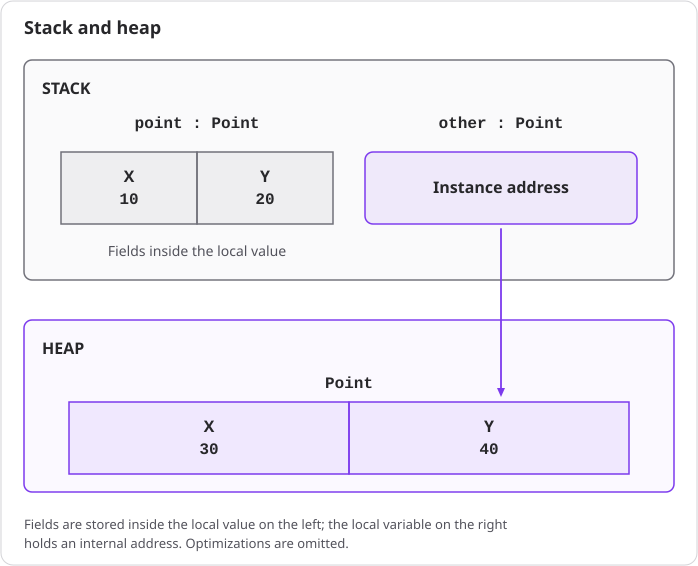
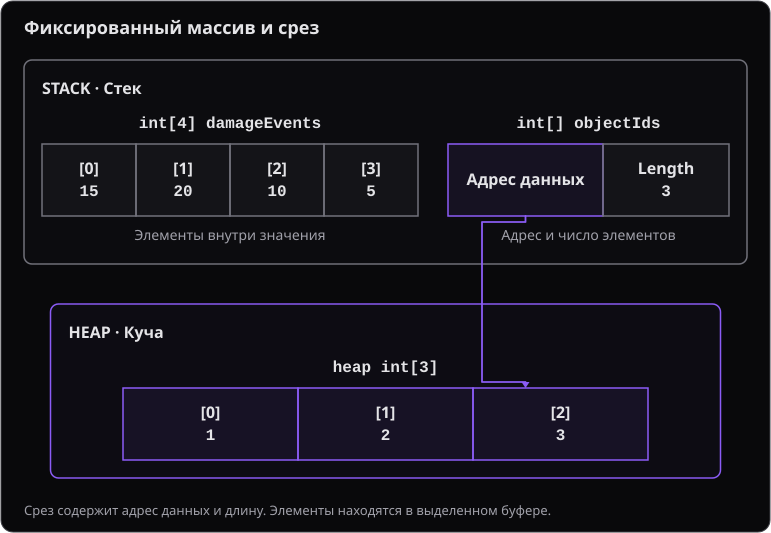
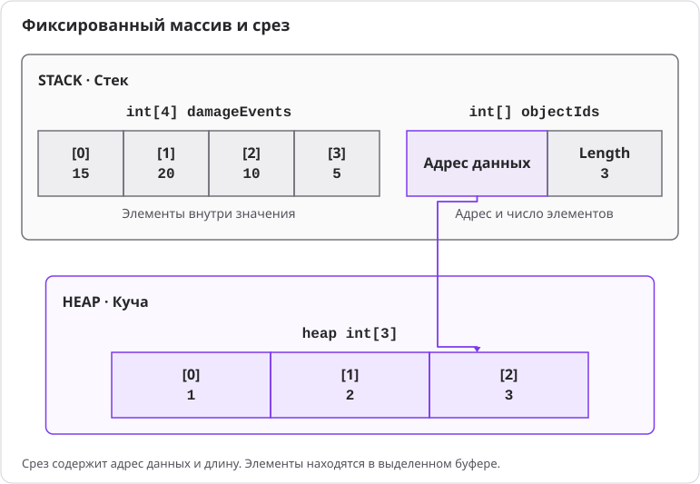
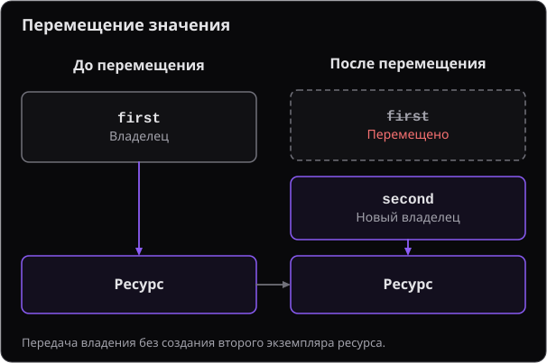
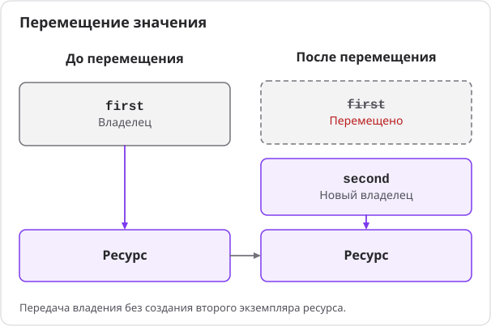
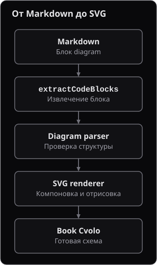
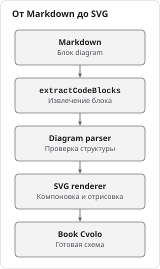

# Diagram exports

These standalone SVG examples are generated from the English authoring guide by Cvolo Visuals. They do not require Book, CSS, JavaScript or external fonts. The localized Book articles keep their own translations.

Regenerate with:

```bash
npm run diagrams:export -- src/content/main/en/authoring/02-code-and-sources/2-6-diagrams.md ./exported both
```

| Dark | Light |
| --- | --- |
|  |  |
|  |  |
|  |  |
|  |  |

[Interactive visualization snapshots](interactive/README.md)
