# Interactive visualization snapshots

These are static SVG snapshots generated by the same renderer used in Book. The live diagrams, controls and source descriptions are in [the Russian authoring guide](../../../src/content/main/ru/authoring/02-code-and-sources/2-7-interactive-diagrams.md) and [the English guide](../../../src/content/main/en/authoring/02-code-and-sources/2-7-interactive-diagrams.md).

| Example | Dark | Light |
| --- | --- | --- |
| entity | 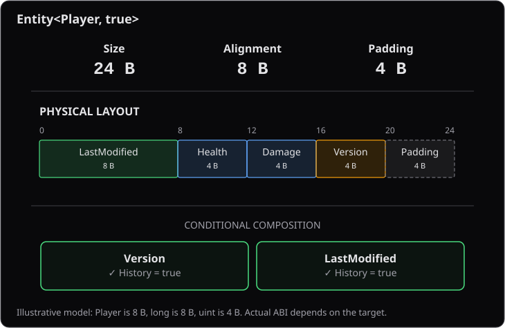 | 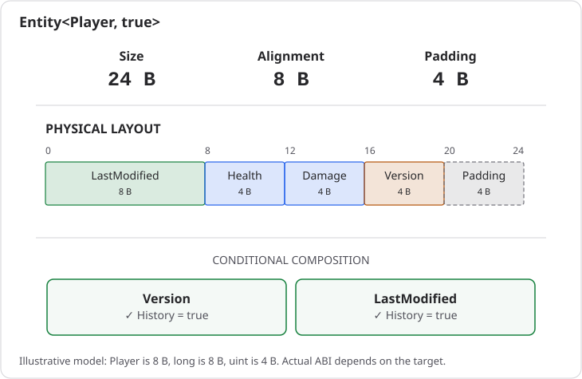 |
| layout-optimization | 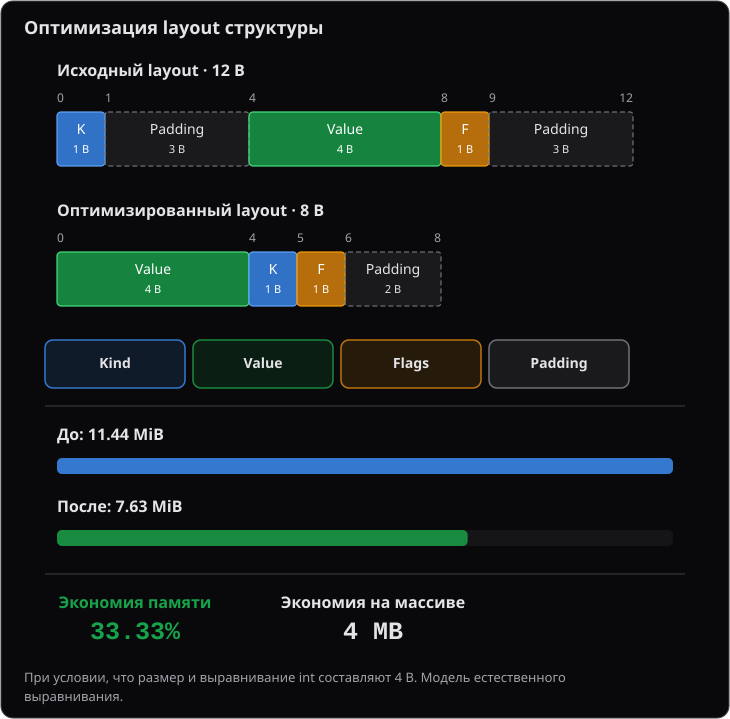 | 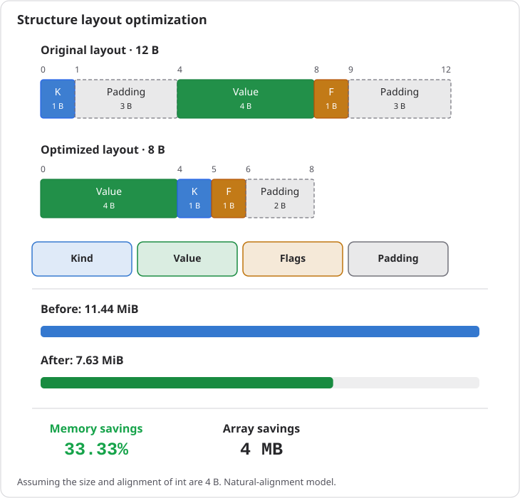 |
| arrays | 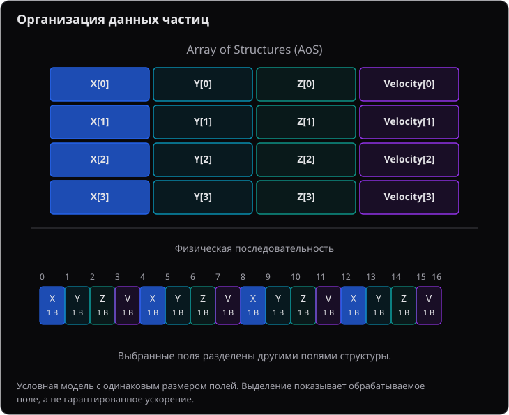 | 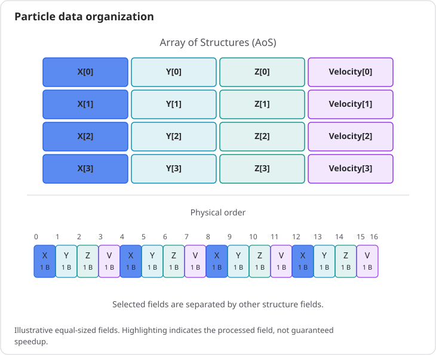 |
| matrix | 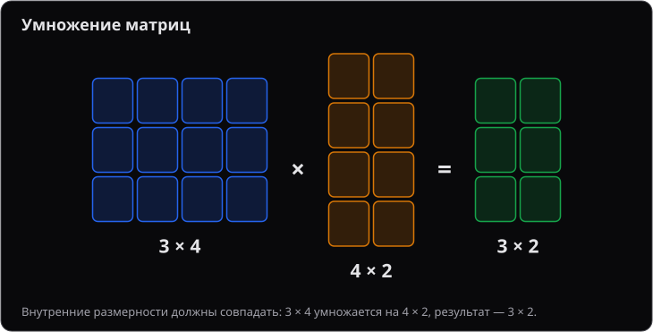 | 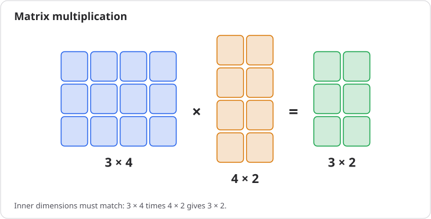 |
| architecture | 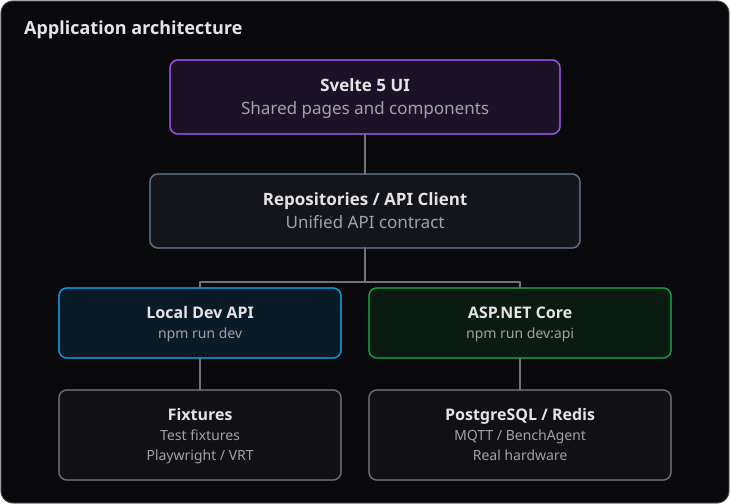 | 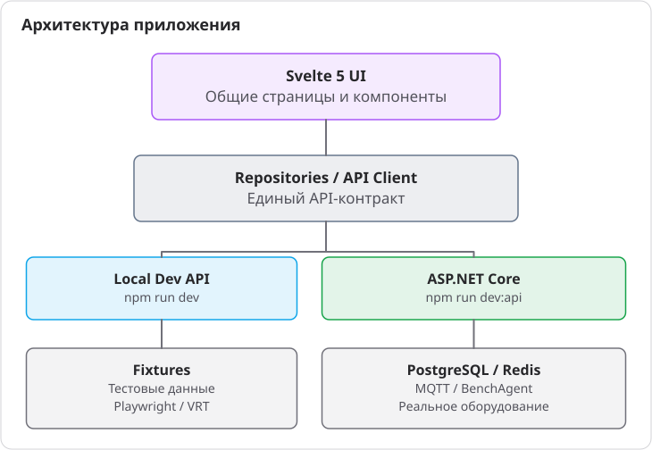 |
| constraints | 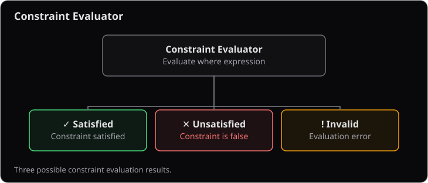 | 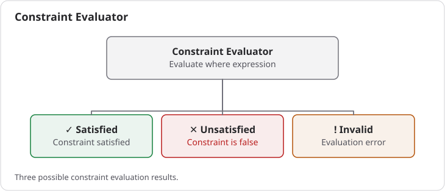 |
| type-set | 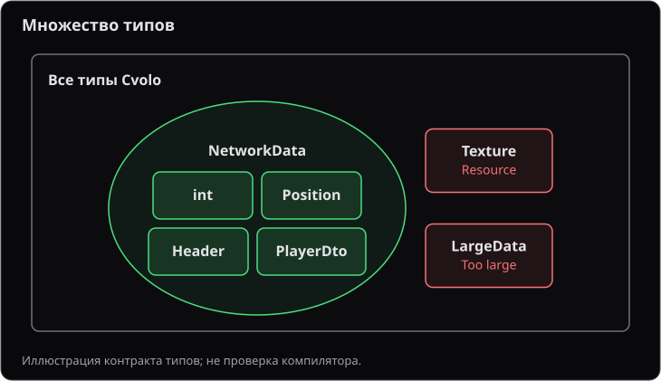 | 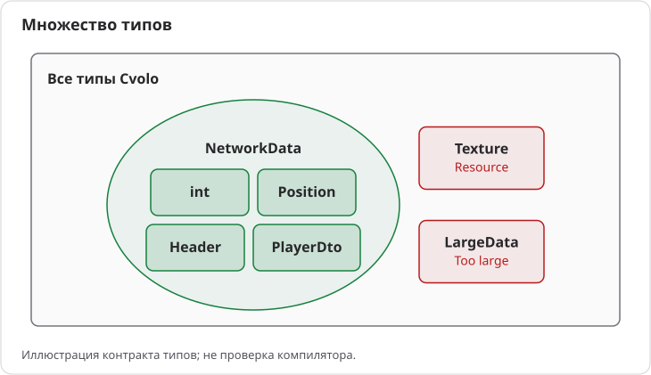 |
| thread-move | 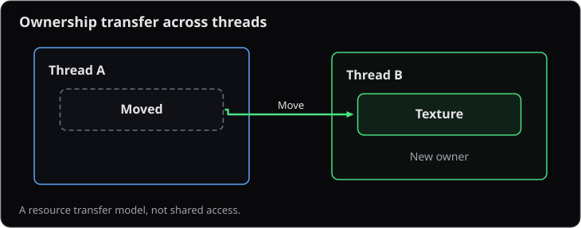 | 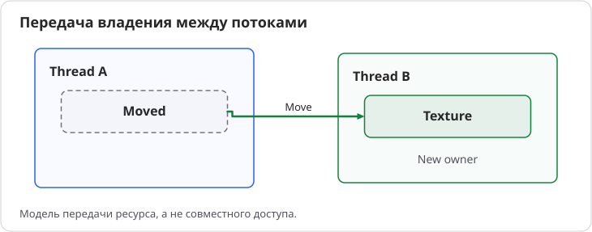 |
| diagnostic | 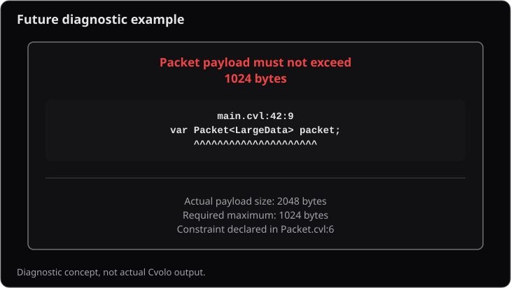 | 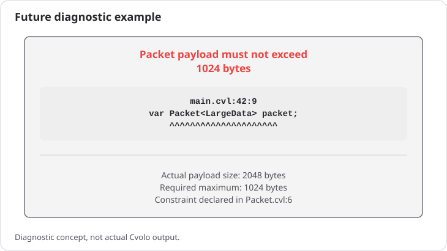 |
| entity-no-history | 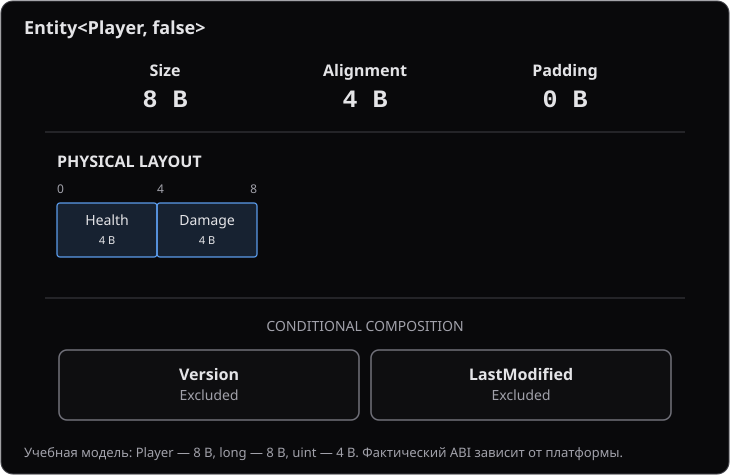 | 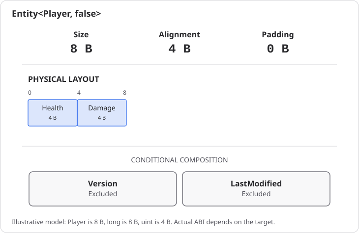 |
| entity-fields | 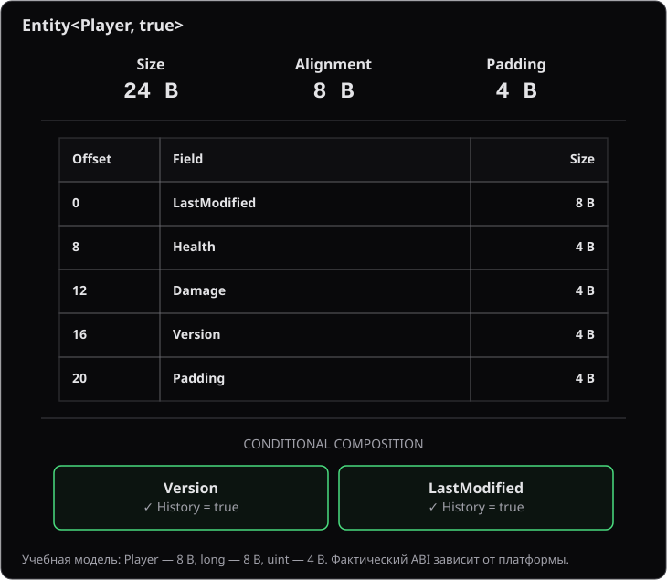 | 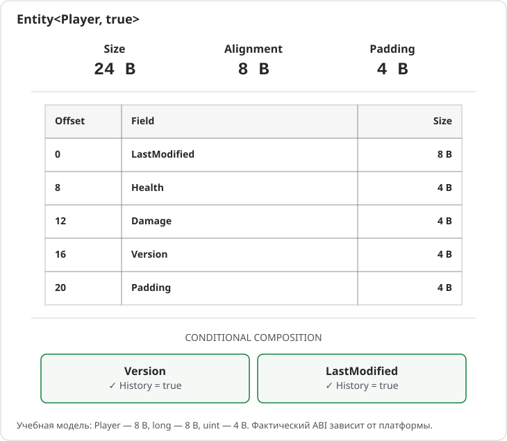 |
| layout-long | 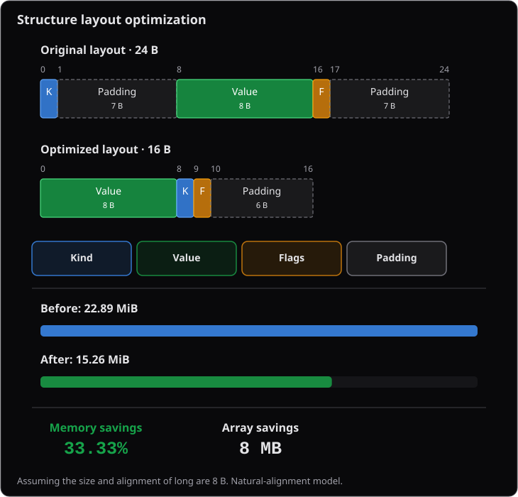 | 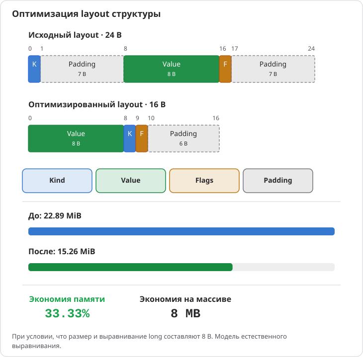 |
| arrays-soa | 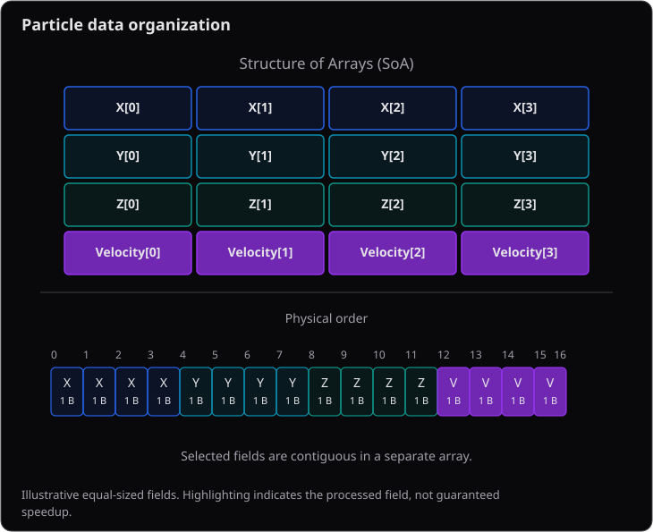 | 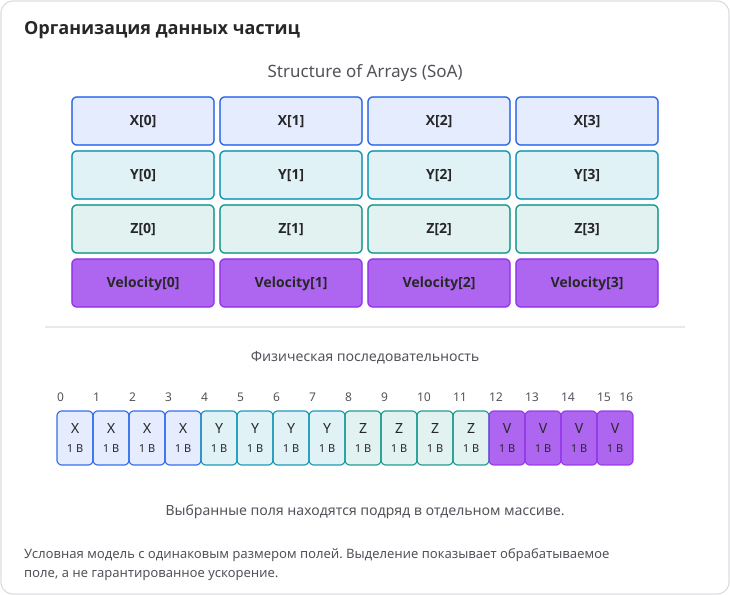 |
